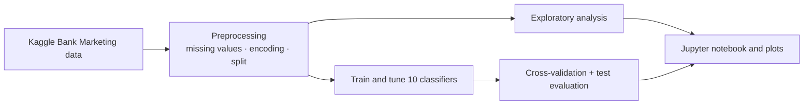
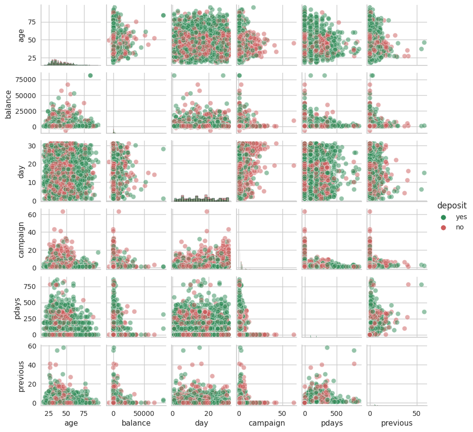
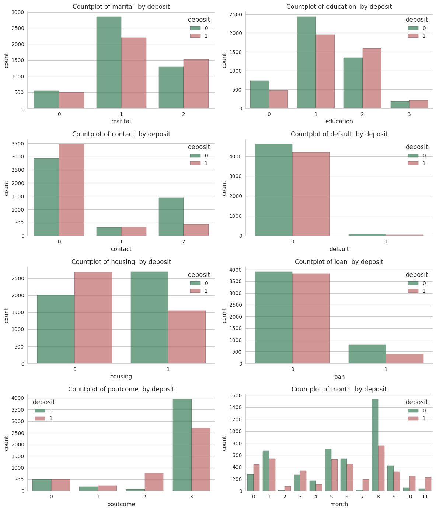
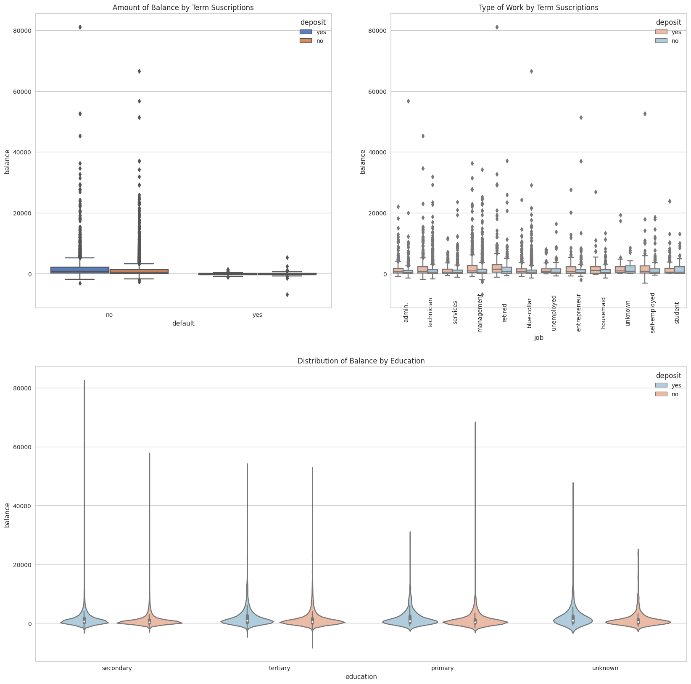

<div align="center">
  
</div>

<div align="center">

**A comparative machine-learning study of bank term-deposit subscriptions.**


[Why this project](#why-this-project) · [Workflow](#workflow) · [Results](#model-results) · [Quick start](#quick-start) · [Dataset](#dataset-and-limitations)

</div>

> **A useful model comparison asks whether performance generalizes beyond the training data.**
>
> This notebook project explores customer and campaign data from the Kaggle Bank Marketing dataset and compares ten classifiers for predicting term-deposit subscriptions. It reports training, cross-validation, and held-out test accuracy to make model fit and generalization visible.

## Why this project?

| Principle | What it means |
| :--- | :--- |
| **Compare multiple baselines** | Logistic regression, tree ensembles, boosting, SVM, KNN, and Naive Bayes are evaluated against the same prediction task. |
| **Look beyond training accuracy** | Cross-validation and held-out test results help reveal models that fit the training set much better than unseen data. |
| **Make analysis inspectable** | The notebook includes data preparation, exploratory analysis, model training, and evaluation steps. |
| **Keep the scope clear** | Results describe this dataset and experiment; they do not establish that a model will improve outcomes in a live banking campaign. |

## Workflow



## Model results

The repository's recorded results show **CatBoost** with the highest reported cross-validation and test accuracy among the listed models:

| Model | Train accuracy | CV mean accuracy | Test accuracy |
| :--- | ---: | ---: | ---: |
| CatBoost | 90.36% | **86.58%** | **85.89%** |
| XGBoost | 100.00% | 85.47% | 84.42% |
| Random Forest | 99.40% | 85.79% | 83.70% |
| Logistic Regression | 82.55% | 82.10% | 81.68% |
| Support Vector Machine | 83.37% | 82.92% | 81.59% |
| K-Nearest Neighbors | 81.81% | 75.38% | 75.19% |
| Decision Tree | 87.51% | 81.92% | 80.25% |
| AdaBoost | 84.04% | 82.91% | 82.58% |
| Extra Trees | 98.76% | 83.38% | 82.22% |
| Gaussian Naive Bayes | 73.92% | 73.58% | 74.56% |

The full comparison is stored in [`Results/models_results.csv`](Results/models_results.csv). Some models have a substantial gap between training and test accuracy, which is a useful reminder to judge generalization rather than training fit alone.

## Exploratory analysis

The repository includes plots for feature distributions, pairwise relationships, and class patterns:

<div align="center">
  
  
</div>

<div align="center">
  
</div>

## Quick start

```bash
git clone https://github.com/Goutham011/Bankterm.git
cd Bankterm
python -m venv .venv
source .venv/bin/activate  # Windows: .venv\Scripts\activate
pip install -r requirements.txt
```

Open [`Model/bank-credit-analysis.ipynb`](Model/bank-credit-analysis.ipynb) in Jupyter Notebook or JupyterLab to review and run the analysis. The dataset is included at [`Dataset/bank.csv`](Dataset/bank.csv); install Jupyter separately if it is not already available in your Python environment.

## Dataset and limitations

The data comes from the [Kaggle Bank Marketing dataset](https://www.kaggle.com/datasets/janiobachmann/bank-marketing-dataset/data). This is a historical, offline classification exercise. Accuracy depends on the dataset's class balance and split, and it does not measure campaign profitability, calibration, fairness, or performance under changing customer behavior. Validate those factors before using a model in an operational decision process.

## Stack

| Layer | Tools |
| :--- | :--- |
| **Analysis** | Jupyter Notebook, pandas, NumPy |
| **Modeling** | scikit-learn, XGBoost, CatBoost |
| **Visualization** | Matplotlib, Seaborn, SHAP, Yellowbrick |

## Repository map

```text
Model/bank-credit-analysis.ipynb   Data exploration, preprocessing, and model comparison
Dataset/bank.csv                   Kaggle Bank Marketing dataset
Results/models_results.csv         Recorded train, CV, and test accuracy
Images/                            Exploratory analysis plots
requirements.txt                   Python analysis dependencies
```

## Built by

<div align="center">

### [Goutham011](https://github.com/Goutham011)

An applied machine-learning project focused on comparing model performance and checking generalization.

</div>
